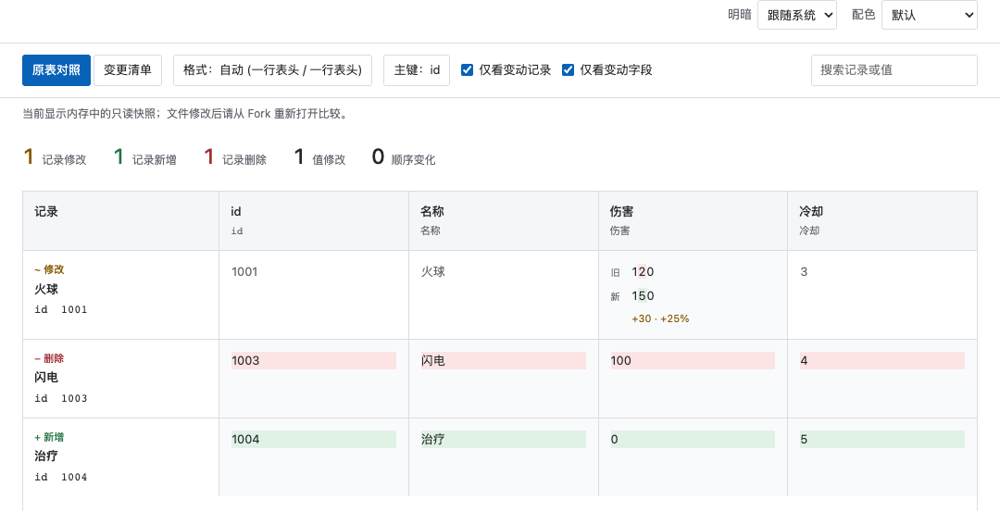

<h1 align="center">Gridiff</h1>

<p align="center">
  <strong>看清每一个单元格的变化。</strong><br>
  在浏览器、VS Code 或 Cursor 中，以表格方式审阅 CSV 与 XLSX。
</p>

<p align="center">
  <a href="https://marketplace.visualstudio.com/items?itemName=sunneeyang.gridiff"></a>
  <a href="https://open-vsx.org/extension/sunneeyang/gridiff"></a>
  <a href="LICENSE"></a>
</p>

<p align="center">
  <a href="#快速开始">快速开始</a> ·
  <a href="#配合-fork-使用">Fork 配置</a> ·
  <a href="docs/INSTALL.md">安装指南</a> ·
  <a href="docs/USAGE.md">使用手册</a>
</p>

<picture>
  <source media="(prefers-color-scheme: dark)" srcset="docs/images/preview-dark.png">
  
</picture>

<p align="center"><sub>实际比较界面，使用虚构演示数据。新增、删除和修改在同一张表中展示。</sub></p>

Gridiff 按主键对齐记录、按字段名对齐列，让你直接看到“哪条记录的哪个字段，从什么值改成了什么值”。适合游戏配置、策划表和 Excel 工作簿审阅，比较过程只读，不改写源文件，也不上传表格数据。

## 为什么用 Gridiff

- **按表格理解变化**：插入一行或调整列顺序后，仍可按主键和字段名查看对应记录。
- **保留阅读上下文**：新增、删除、修改按源表顺序放在一起；未变化的单元格弱化显示。
- **适配配置表**：支持普通表头、自定义多行表头、Mova 四行表头与竖表；保留文本前导零和长 ID。
- **缩小审阅范围**：搜索当前工作表全部记录，筛选变动记录与字段，按页查看；XLSX 可选择首表、全部表或指定表。
- **选择熟悉的环境**：独立程序在默认浏览器展示，扩展在 VS Code / Cursor 中独立运行。比较网页默认跟随系统明暗，并提供多套配色；插件跟随编辑器主题。

## 快速开始

先选择你想在哪里看差异：

| 使用方式 | 安装与打开 |
| --- | --- |
| **VS Code** | 在扩展面板搜索 `@id:sunneeyang.gridiff`，安装 **Gridiff — Visual Table Diff**，然后打开 CSV 或 XLSX 差异。 |
| **Cursor** | 在 Cursor 扩展面板搜索同一扩展 ID；搜索不到时，从 [Open VSX](https://open-vsx.org/extension/sunneeyang/gridiff) 下载 VSIX，通过 **Install from VSIX…** 安装。 |
| **浏览器 / 策划库自带程序** | 团队仓库已有 `gridiff/` 时，更新仓库及 Git LFS 文件，然后双击其中与 README 同级的 **安装与使用.html**，按向导配置 Fork。无需安装编辑器或额外运行时。 |

确认扩展发布者为 **sunneeyang**。编辑器扩展无需安装独立 Gridiff 程序；仅打开单个文件不会启动对比。

> **第一次使用？** 从 [图文安装说明](docs/INSTALL.md) 开始。仓库根目录的 [安装与使用.html](安装与使用.html) 可离线按系统和工具展示步骤，支持复制参数、明暗切换与配色选择。下载时保留 `docs/guide/` 资源目录；GitHub 直接打开 HTML 会显示源码。

独立程序的源码构建与团队仓库分发见 [开发文档](DEVELOPMENT.md#独立程序)。源码仓库不直接携带可执行程序。

## 配合 Fork 使用

在 Fork 的 **Settings / Preferences → Integration → External Diff Tool** 中配置一次。Fork 支持 macOS 和 Windows；Linux 可从终端或编辑器独立使用 Gridiff。

| 目标工具 | Fork 中的选择 / File Path | Arguments |
| --- | --- | --- |
| **VS Code** | 选择内置 **VSCode / Visual Studio Code** | 使用内置配置 |
| **Cursor** | 选择自定义工具，定位 Cursor 的命令行入口 | `--wait --diff $REMOTE $LOCAL` |
| **仓库自带 Gridiff** | 选择自定义工具，定位 `<仓库>/gridiff/gridiff`；Windows 选择 `gridiff.cmd` | `$REMOTE $LOCAL` |

**所有入口统一为旧文件在前、新文件在后。** Fork 自定义工具必须按上表填写顺序，占位符不要加引号；Merge Tool 保持原设置。完整步骤与快捷键见 [安装说明](docs/INSTALL.md)，按系统展示的文件选择步骤和配图见 [离线图文指南](安装与使用.html)。

在含有独立可执行程序的目录，也可以直接调用：

```sh
./gridiff "旧版本.csv" "新版本.csv"
./gridiff --sheets all "旧版本.xlsx" "新版本.xlsx"
```

## 开始审阅

1. **保存表格**。在 Fork 选择提交或本地修改，再单击文件列表中的 CSV / XLSX，右键选择 **External Diff**。文件列表获得焦点后，也可用 macOS `⌘D` / Windows `Ctrl+D`。
2. **确认方向与对齐**。先核对顶部旧、新来源，再看“格式”和“主键”；通常保留自动识别即可。编辑器中也可运行 **Gridiff: 比较两个文件…**，依次选择旧、新版本。
3. **查看变化**。使用原表对照或变更清单，通过搜索、筛选与分页定位记录。

| 标记 | 含义 |
| --- | --- |
| **+ 新增** | 绿色新值，只展示新增内容 |
| **− 删除** | 红色旧值，只展示移除内容 |
| **~ 修改** | 同一单元格显示旧值、新值，并突出变化片段 |
| **灰色文字** | 未变化的值，保留阅读上下文 |

文件修改后，**网页模式从 Fork 再打开一次**，“重新计算”只使用已有快照；**插件模式点击“重新读取”**。审阅结束时，网页可点“结束比较”；插件经 Fork 的 `--wait` 启动时，还需关闭原始差异标签，Fork 才会结束等待。

## 支持范围

| 项目 | 当前行为 |
| --- | --- |
| 文件 | UTF-8 CSV、XLSX；只比较两份同格式文件，不支持 `.xls`、TSV 或加密工作簿 |
| 工作表 | **插件默认读取全部表，独立程序默认只读首表**；两者均可配置读取范围 |
| 公式 | 比较文件中保存的结果，不重算公式；字体、颜色、图表等排版变化不参与比较 |
| 独立程序平台 | macOS ARM64 / x64、Linux ARM64 / x64、Windows x64；未提供 Windows ARM64 原生程序 |
| 数据上限 | 单侧文件最多 8 MiB；XLSX 解压大小和单元格数量另有预算，见 [完整限制](docs/USAGE.md#当前限制) |

macOS ARM64 的 Fork CSV / XLSX 对比已验证；其余平台完成交叉构建，Windows、Linux 与远程工作区尚未完成实机验收。

## 项目文档

| 文档 | 内容 |
| --- | --- |
| [安装说明](docs/INSTALL.md) | 三种安装路线、Fork 配置、快捷键与常见问题 |
| [离线图文指南](安装与使用.html) | 下载后本地打开，按系统与工具逐步操作 |
| [使用与配置](docs/USAGE.md) | 主键、表头、Mova 规则、XLSX 语义、筛选分页与限制 |
| [插件说明](README.extension.md) | VS Code / Cursor 专用使用说明，也是 VSIX 的 README 来源 |
| [开发与发布](DEVELOPMENT.md) | 构建、测试、团队仓库同步与发布流程 |
| [性能记录](PERFORMANCE.md) | 测量方法、环境和优化结果 |
| [更新记录](CHANGELOG.md) | 版本变化 |

Gridiff 使用 [MIT 许可证](LICENSE)。问题或建议可提交到 [GitHub Issues](https://github.com/SunneeYang/gridiff/issues)。
